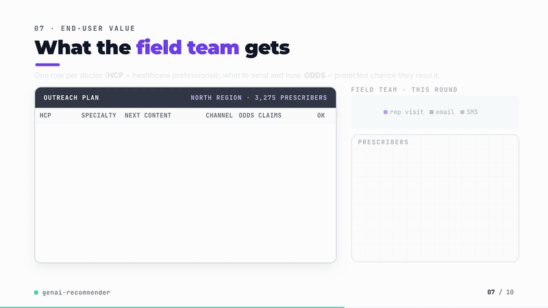
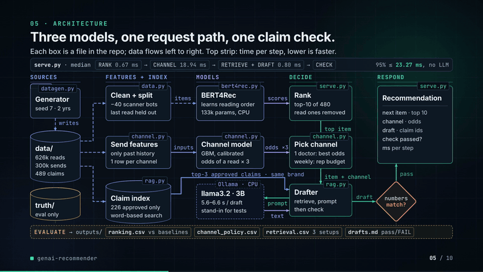
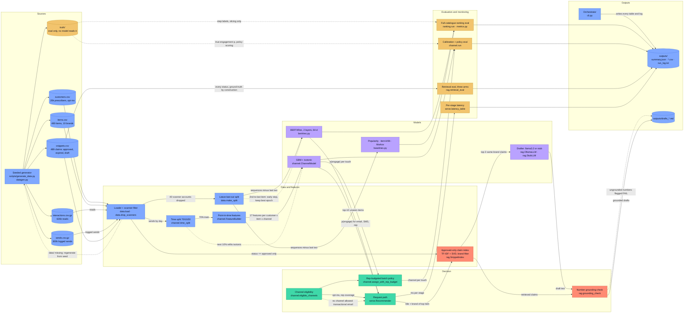

# genai-recommender

[](https://github.com/kavya2693/genai-recommender/actions/workflows/ci.yml)


Next piece of content, the channel to send it through, and a message that only quotes approved
claims, for a commercial team that reaches 20,000 prescribers by email, SMS and rep visits.
Measured against the baselines it has to beat, including the one it does not.

[](docs/demo/demo.mp4)

*86-second silent walkthrough. Click for the full video ([MP4, 5 MB](docs/demo/demo.mp4)).*

📄 **Audit report:** every figure and assumption in the video, traced to its source — [PDF](docs/demo/AUDIT_REPORT.pdf) · [Word](docs/demo/AUDIT_REPORT.docx) · [Markdown](docs/demo/AUDIT_REPORT.md)

## At a glance

| | |
|---|---|
| **Problem** | A pharmaceutical commercial team has a 480-item catalogue of approved educational content and 20,000 prescribers. Every week it has to choose what each prescriber gets next, whether it goes by email, SMS or a rep visit (a fixed headcount), and what the message says, and the message may only quote claims medical-legal review approved. Expired claims read almost exactly like current ones. |
| **Approach** | Three separate decisions, each with its own ground truth: a small BERT4Rec scored over the full catalogue against popularity, item-kNN and a last-item Markov chain; a calibrated gradient-boosted channel model feeding a rep-budgeted policy; and claim governance enforced in the retrieval index (approved claims only, filtered by brand) before a local LLM writes the message and a check matches every number against the retrieved claims. |
| **Result** | At the historical rep budget the channel policy reaches **206.6 engaged per 1,000 touches against 189.8 logged (+8.9%)**, **62% of the oracle's lift**. The approved, brand-filtered index puts **0 unapproved claims** in front of the model, against **73.4% of queries** when every claim is indexed (precision@3 0.954). The request path without the LLM runs at **20.4 ms p50**. |
| **What didn't win** | BERT4Rec loses to the last-item Markov chain (NDCG@10 **0.303 vs 0.316**); it only wins on resuming a series (+0.086). The GBM is 0.007 AUC better than a logistic regression and isotonic recalibration bought almost nothing. All three llama3.2 drafts passed the number check, and two still made claims nothing supports. |

## Architecture





Solid edges are the data flow of one run; dotted edges are fallback, feedback and evaluation-only
paths. Red nodes are where claim governance is enforced: what the model can see, and what its
output is checked against.

### Components

| Component | Responsibility | File |
|---|---|---|
| Data generator | Five tables over two years (prescribers, catalogue, reads, logged sends, claim snippets) plus a `truth/` folder used only to slice results and score channel policies | [`scripts/generate_data.py`](scripts/generate_data.py), [`src/genai_recommender/datagen.py`](src/genai_recommender/datagen.py) |
| Loader and split | Reads the tables, drops link-scanner accounts (more than 40 reads in a day), builds the leave-last-out split | [`src/genai_recommender/data.py`](src/genai_recommender/data.py) |
| Baselines | Popularity, item-kNN and a first-order last-item Markov chain | [`src/genai_recommender/baselines.py`](src/genai_recommender/baselines.py) |
| Sequence model | BERT4Rec with random and last-position-only masking, early stopping on validation NDCG@10, scoring over the full catalogue | [`src/genai_recommender/bert4rec.py`](src/genai_recommender/bert4rec.py) |
| Ranking evaluation | Trains every ranker on the same split, scores HR, NDCG and coverage at 10, slices by step type and new content | [`src/genai_recommender/ranking.py`](src/genai_recommender/ranking.py), [`src/genai_recommender/metrics.py`](src/genai_recommender/metrics.py) |
| Channel model and policy | Point-in-time features, GBM with isotonic recalibration, logistic baseline, eligibility, rep-budgeted assignment, policy scoring | [`src/genai_recommender/channel.py`](src/genai_recommender/channel.py) |
| Claim retrieval and drafting | Approved-only index with brand filter, retrieval experiment, prompt, stub and Ollama clients, grounding check | [`src/genai_recommender/rag.py`](src/genai_recommender/rag.py) |
| Request path | One prescriber in, top item, channel and checked draft out, with each stage timed | [`src/genai_recommender/serve.py`](src/genai_recommender/serve.py) |
| Orchestrator | One command end to end; writes every table, log and draft to `outputs/` | [`src/genai_recommender/cli.py`](src/genai_recommender/cli.py) |

### Design decisions

| Decision | Options considered | Chosen | Trade-off |
|---|---|---|---|
| Where claim governance lives | An instruction in the prompt ("do not use expired claims"); filtering after generation; filtering the index | Only approved claims are indexed, retrieval is filtered by brand before ranking, and every number in a draft is checked against the retrieved claims ([ADR-0001](docs/adr/0001-governance-in-the-index-not-the-prompt.md)) | The model never sees a wrong claim, but the number check is all that stands between it and an unsupported sentence; prose-level errors still pass |
| One model or three | One joint model for content, channel and message; three decisions with separate ground truth | Three, each with its own scoreboard | Each result is measurable on its own, but the channel model never asks whether a different item would have engaged better through the chosen channel |
| How rep visits are allocated | Unconstrained argmax; email unless opted out; a fixed rep budget given to the widest predicted rep advantage | Rep budget equal to the historical share, spent on the largest predicted gain over the best digital channel | A plan a field team can run; it only applies in the batch, so the single-request path takes the eligible argmax |
| Next-content ranker | Popularity; item-kNN; last-item Markov; BERT4Rec; sampled-negative evaluation against full-catalogue scoring | BERT4Rec on the request path, every ranker scored over all 480 items with no sampled negatives | Honest numbers, and they show the Markov chain winning overall; BERT4Rec is kept for its long-range wins and a blend is the next experiment |
| Claim embeddings | Hosted embedding model; FAISS; TF-IDF + truncated SVD with cosine in numpy | TF-IDF + SVD, 64-d, in numpy | No download or key, so CI is hermetic; lexical, and it needs revisiting at tens of thousands of claims |
| Language model | Hosted LLM; local llama3.2 through Ollama; deterministic stub | llama3.2 for demos, the stub in tests and CI | No key and a reproducible test suite; 5.6 to 6.6 s per draft on CPU, which sets the latency budget |

### Data contracts

| Stage | Input | Output |
|---|---|---|
| Generator to loader | scale (customers), seed | `customers.csv`: `customer_id, specialty, region, years_in_practice` (float), `digital_affinity` (float), `rep_covered, email_opt_in, sms_opt_in` (bool); `items.csv`: `item_id, title, therapeutic_area, brand, topic, format, series_id, episode` (int), `release_date`; `interactions.csv.gz`: `customer_id, item_id, ts` (datetime), `channel, dwell_seconds` (float); `sends.csv.gz`: `send_id, customer_id, item_id, sent_at` (datetime), `channel` (email, sms, rep), `recent_touches` (int), `engaged` (0/1); `snippets.csv`: `snippet_id, brand, topic, therapeutic_area, kind, status` (approved, expired, draft), `text` |
| Split | interactions after the scanner filter | `Split`: `customer_ids`, `train: list[ndarray]` of item ids (all but the last two), `valid_target`, `test_history`, `test_target`, `test_ts`, `n_items` |
| Rankers | item-id histories | `ndarray[n_users, n_items + 1]` scores; seen items masked before top-10 |
| Channel model | rows `customer_id, item_id, day, channel, recent_touches` | 17 features (5 categorical, 12 numeric, history looked up strictly before `day`) to `p(engage)` in [0, 1] per row |
| Batch policy | `p` and eligibility, both `[n_touches, 3]`, rep budget (int) | channel index per touch |
| Retrieval | query text (content title), `k = 3`, brand | up to `k` snippet rows with `score` (cosine); fewer when the brand has fewer approved claims |
| Drafter | specialty, item row, channel | `snippet_ids, draft, numbers` (int), `ungrounded` (list of str), `grounded` (bool) |
| Request path | `customer_id`, history, day, recent touches | `Recommendation`: `top10, item_id, channel, channel_p` (dict), `draft`, `ms` per stage |

### Failure modes and fallbacks

| Failure | What the code does |
|---|---|
| Dataset missing | If `data/interactions.csv.gz` is absent, the run regenerates every table from the seed before training. There is no live feed, so there is no late-data path. |
| Link-scanner bursts in the read log | Any prescriber with more than 40 reads in one day is dropped entirely (40 in the full run), because the rest of a scanned inbox is not trustworthy as preference either. |
| Prescriber with little or no history | Prescribers with fewer than three reads are left out of the split. In the channel model, engagement history is smoothed toward the training base rate with a pseudo-count of 5, so a prescriber with no sends gets the base rate, and a missing region becomes its own `unknown` category. Cold-start ranking is not evaluated. |
| No channel allowed for a prescriber | Eligibility falls back to transactional email, which is always allowed. |
| Category at request time not seen in training | Categorical features are mapped onto the training category codes; an unseen value becomes missing, which the GBM handles natively. |
| BERT4Rec stops improving | Training is evaluated every two epochs on the second-to-last item for 3,000 prescribers; after three evaluations without improvement it stops and restores the best checkpoint. |
| Retrieval finds fewer than three claims for a brand | Only same-brand rows are returned, even if that is fewer than `k`; the draft may then only quote numbers in those claims or the content title. |
| Draft contains a number no retrieved claim supports | The grounding check lists it and the draft is written to `outputs/drafts_*.md` marked FAIL. There is no regeneration and no send step. Wrong prose around correct numbers is not caught; this is the biggest gap in the limitations below. |
| LLM slow or down | `OllamaLLM` gives each draft a 300 s timeout with no retry or template fallback, so a failure ends the `--llm ollama` demo run. The default run, the tests and CI use the stub and never call a model server. |
| Model or data drift | Not handled. Every model is retrained on each run and nothing is monitored; listed in the limitations below. |
| `truth/` folder missing | Slice tables and the policy comparison are skipped; ranking, calibration and retrieval still run. |

### Path to production

This is a mapping of each local piece to what would replace it in a deployed system, not a
description of one that exists.

| Here | Production equivalent |
|---|---|
| Seeded generator writing CSVs to `data/` | CRM call logs, email and SMS provider events and content analytics landed in a warehouse (BigQuery, Snowflake or Redshift), partitioned by event date |
| pandas loader, scanner filter and point-in-time history lookups | SQL or dbt models, and a feature store (Feast, Vertex AI or SageMaker Feature Store) with point-in-time joins so the training and request paths share one definition |
| `make run` on a laptop | Scheduled pipeline in Airflow or Step Functions: weekly retrain of the ranker and channel model, evaluation against the incumbent on the latest held-out week, promotion only if it wins |
| BERT4Rec and GBM trained in process on CPU | Training jobs on SageMaker or Vertex AI, versioned in a model registry (MLflow or the cloud registry) |
| In-process `Recommender` | A container service (Cloud Run, ECS or Kubernetes) or a managed endpoint, with channel features precomputed per prescriber, since the pandas feature frame is where the non-LLM latency is |
| TF-IDF + SVD index in numpy | Neural embeddings in a vector store with metadata filters (pgvector or OpenSearch), filtering on `status` and `brand` before ranking, rebuilt on every medical-legal approval or expiry |
| llama3.2 through Ollama | Managed LLM endpoint (Bedrock or Vertex AI) or self-hosted vLLM, with a timeout, retries and a fixed template as fallback |
| Number grounding check | Claim-level entailment check per sentence, then a human approval queue before anything is sent |
| Policy scored against the generator's engagement function | Off-policy estimation on logged propensities, confirmed by a randomised holdout |
| Monitoring (not built) | Weekly NDCG@10 on last-event holdout against the Markov baseline; ECE per channel; rep share against budget; unapproved-claim retrieval rate as a hard alert at anything above 0; grounding failure rate; p95 latency per stage and LLM timeouts |

## The problem

A pharmaceutical commercial team has about 500 pieces of approved educational content (articles,
dosing guides, webinars, multi-part series, congress recaps) and 20,000 prescribers to send them
to. Every week someone decides, for each prescriber, what to send next, whether it goes by email,
SMS or in a rep's visit, and what the message says. Today that is a segment rule and a template:
everyone in cardiology gets the same webinar invite by email, and reps visit whoever is on
their list.

Three things cost money. Content that does not follow on from what a prescriber just read gets
ignored. Rep visits are the most expensive touch and a fixed headcount, so a visit spent where an
email would have done the same job is a visit lost somewhere it mattered. And the message itself
is regulated: it may only quote claims that medical-legal review approved. A draft that quotes a
superseded efficacy figure is a compliance incident, not a typo, and the old and new versions of
a claim read almost identically.

## Why it is hard

None of the three pieces needs a large model. The hard part is evaluation and control. A
sequence model is easy to report as a win against popularity; the question is whether it beats
the simplest model that knows what was read last. A channel model can rank well and still be
overconfident on one channel, and with a rep budget that sends reps to the wrong doors. And a
language model asked to "only use approved claims" cannot tell an approved 22% from an expired
18% when both are in its context, because the text around the number is identical.

## The approach

Three separate decisions, each with its own ground truth ([ADR-0001](docs/adr/0001-governance-in-the-index-not-the-prompt.md)):

- **Next content:** a small BERT4Rec (2 layers, 64 dimensions, 30-item window, 133k parameters)
  trained on CPU by masked-item prediction, scored over the full 480-item catalogue with no
  sampled negatives, against popularity, item-kNN and a last-item Markov chain.
- **Channel:** a gradient-boosted classifier over (customer, content, channel) features,
  recalibrated with isotonic regression on a later slice of time. The batch policy keeps the
  historical number of rep visits and gives them to the touches where a rep beats the best
  digital channel by the widest predicted margin.
- **Message:** retrieval over claim snippets, then a local LLM (llama3.2 through Ollama; a
  deterministic stub in tests and CI) writes the message around them.

The key decision is where claim governance lives: in the index, not the prompt. Only `approved`
snippets are embedded, retrieval is filtered to the recommended content's brand before ranking,
and every number in the draft is checked against the retrieved claims. The model can write the
prose; it never gets the chance to pick the wrong claim.

## The result

One run of `make demo` on a laptop CPU (Apple M1 Pro, 4 threads, no GPU; 233 s wall clock
including three llama3.2 drafts): 19,960 prescribers, 576,746 training events, last event per
prescriber held out. BERT4Rec early-stopped at epoch 22 (validation NDCG@10 0.303, 196 s of
training). Full log: [`outputs/run_log.txt`](outputs/run_log.txt),
all numbers: [`outputs/summary.json`](outputs/summary.json).

**The finding I did not want: BERT4Rec does not beat a first-order Markov chain.**

| Ranker, full catalogue | HR@10 | NDCG@10 | Coverage@10 |
|---|---:|---:|---:|
| Popularity | 0.050 | 0.024 | 0.108 |
| Item-kNN | 0.186 | 0.102 | 0.888 |
| Last-item Markov | **0.421** | **0.316** | 0.956 |
| BERT4Rec | 0.388 | 0.303 | 0.954 |

It beats popularity and item-kNN by a wide margin, which is the comparison most write-ups stop
at. Against "what usually follows the last thing you read" it loses 0.013 NDCG@10. Split by the
kind of step the held-out event was (labels come from the generator and are used only to slice):

| NDCG@10 by step type | Prescribers | Last-item Markov | BERT4Rec |
|---|---:|---:|---:|
| Next episode of a series | 3,624 | 1.000 | 0.999 |
| Back to a series after reading other things | 2,392 | 0.375 | **0.461** |
| Format pathway (article, then dosing guide) | 4,145 | **0.365** | 0.232 |
| Free choice by specialty preference | 9,799 | 0.027 | 0.038 |
| Content released in the last 30 days | 189 | 0.052 | 0.059 |

BERT4Rec wins where the answer depends on something further back than the last item (resuming a
series: +0.086), and loses badly on format pathways, where the last item is all that matters and
the Markov table has it exactly. Half the test set is free choice, where every model is near
zero; that ceiling comes from the noise in the data, not from the models.

**Channel model.** Last 20% of 299,722 logged sends by time:

| Model | AUC | Log loss | Brier | ECE |
|---|---:|---:|---:|---:|
| Logistic regression | 0.683 | 0.450 | 0.142 | 0.0053 |
| GBM, raw | 0.690 | 0.445 | 0.140 | 0.0051 |
| GBM + isotonic | 0.689 | 0.447 | 0.140 | 0.0046 |

Second disappointment: the GBM is only 0.007 AUC better than a logistic regression, and isotonic
recalibration bought almost nothing because the raw GBM was already calibrated (ECE 0.0051 to
0.0046, log loss slightly worse). The reliability table is in
[`outputs/channel_reliability.csv`](outputs/channel_reliability.csv).

What the model is for is the policy. Each policy is scored with the generator's true engagement
probability for the channel it picks, on the same touches, so it is not limited to the channels
that happened to be logged:

| Policy | Engaged per 1,000 touches | Rep share | SMS share | Share of oracle lift |
|---|---:|---:|---:|---:|
| Logged (historical) | 189.8 | 13.3% | 11.7% | 0% |
| Email unless opted out | 172.0 | 2.6% | 3.8% | -65% |
| Model, same rep budget | **206.6** | 11.5% | 4.7% | **62%** |
| Oracle, same rep budget | 217.1 | 11.8% | 11.0% | 100% |

At the historical rep budget the model lifts engagement 8.9% over the logged policy and recovers
62% of what perfect knowledge of each prescriber would. It also uses fewer rep visits than it was
allowed (11.5% against 13.3%), because past a point the predicted rep advantage is not positive.
Its SMS share (4.7% against the oracle's 11.0%) is where most of the remaining gap is: SMS
affinity is mostly hidden in the generator and the observable features barely carry it.

**Claim retrieval.** 79 brand-topic queries, k = 3, ground truth by construction:

| Index | Precision@3 | All right claims found | Any unapproved claim retrieved | Any other-brand claim retrieved |
|---|---:|---:|---:|---:|
| Every status indexed | 0.549 | 31.6% | **73.4%** | 1.3% |
| Approved only | 0.945 | 97.5% | 0% | **15.2%** |
| Approved only + brand filter | 0.954 | 100% | 0% | 0% |

Indexing every claim and asking the model to avoid expired ones would put an unapproved claim in
front of it for 73% of queries. Removing expired claims from the index fixes that and exposes the
next failure: 15% of queries pull another brand's claim on the same topic. The brand filter
closes both.

**Latency of the request path.** 300 requests, one at a time, one thread, stub drafter
([`outputs/latency.csv`](outputs/latency.csv)):

| Stage | p50 ms | p95 ms | max ms |
|---|---:|---:|---:|
| Rank (BERT4Rec over 480 items) | 0.67 | 0.78 | 9.78 |
| Channel (features + GBM + isotonic) | 18.94 | 21.40 | 50.19 |
| Retrieve + draft (stub) | 0.80 | 1.10 | 2.87 |
| Total | 20.44 | 23.27 | 53.82 |

The transformer is not the slow part: ranking takes under a millisecond. Almost all of the
non-LLM time is the channel model building a three-row pandas feature frame and calling the GBM.
Forcing the GBM's OpenMP pool to one thread mattered; on this shared machine its start-up alone
cost about 50 ms per request. The max column is first-touch outliers on a busy host, not steady
state.

With a real model the picture flips. Three llama3.2 drafts (3B, CPU through Ollama) took 5.6, 6.2
and 6.6 seconds each, roughly 300 times the rest of the request path combined, so the drafting
step, not the recommender, sets the latency budget. All three passed the grounding check
([`outputs/drafts_llama3.2.md`](outputs/drafts_llama3.2.md)). Three samples is a demonstration,
not a measured pass rate.

## How it works

```
seeded generator ─► customers, items, interactions, sends, claim snippets   (+ truth/, eval only)
        │
        ├─► scanner filter ─► leave-last-out split ─► popularity | item-kNN | Markov | BERT4Rec
        │                                              (early stop on 2nd-to-last item, 3,000 users)
        ├─► sends, time split 70/10/20 ─► GBM ─► isotonic on the 10% ─► rep-budgeted policy
        └─► approved snippets only ─► TF-IDF + SVD (64-d), cosine in numpy

request(customer):  BERT4Rec top-10, unseen ─► top item ─► p(engage) for email/SMS/rep,
                    eligible argmax ─► brand-filtered top-3 claims ─► LLM draft ─► grounding check
```

- `datagen.py` writes the five tables and a `truth/` folder (hidden channel affinities, the kind
  of step behind each interaction, true send probabilities). No model reads `truth/`; it is used
  to slice results and to score channel policies.
- `data.py` drops prescribers with link-scanner bursts (more than 40 opens in a day; 40 dropped)
  and makes the split: train on all but the last two events, validate on the second-to-last,
  test on the last.
- `bert4rec.py` trains with two masking modes per batch: random 20% masking, and half the time
  only the last position, which is what inference asks for. Early stopping on validation NDCG@10.
- `channel.py` builds features whose engagement history is looked up strictly before the send's
  day, fits the GBM, recalibrates, and runs the policy comparison.
- `rag.py` holds the index, the prompt, the stub and Ollama clients, and the grounding check.
- `serve.py` is the timed request path; `cli.py` runs everything and writes `outputs/`.

The per-request path takes the eligible argmax channel; the rep budget only applies in the batch
policy, because a single request has no budget to share.

## Running it

```bash
uv sync
make check        # ruff, format, mypy, pytest
make run          # generates data/ if missing, trains and evaluates; about 5 minutes on 4 CPU threads
make demo         # same, plus three drafts from llama3.2 through a local Ollama server
make data         # regenerate the dataset only
docker build -t genai-recommender . && docker run --rm genai-recommender
```

`make run` and the tests need no API key and no model server. `make demo` expects
`ollama pull llama3.2`; `OLLAMA_NUM_GPU=0` (set by the Makefile) forces CPU inference on hosts
where the GPU path crashes. CI runs the tests and a quick end-to-end run on 1,500 prescribers.

## The data

The dataset is generated by the seeded script `scripts/generate_data.py` (`make data`) and sized
to the production problem: 20,000 prescribers in six specialties, 480 content items across ten
brands in five therapeutic areas (55 multi-part series), 626,414 content interactions and
299,722 outbound sends over two years, and 489 claim snippets (226 approved, 252 expired, 11
draft). The production data is proprietary. The brand names are invented.

Behaviour planted in the generator, partly hidden from the models: series continuation and
resumption, format pathways within a brand, specialty preference, a launch boost for new content,
weekday and holiday seasonality, contact fatigue from recent touches, and per-prescriber channel
affinities that observed features only partly reveal. Forty prescribers are link-scanner bots.
Expired claims share brand, topic and wording with the approved version and differ only in the
numbers.

## Tests

`make check` runs 19 tests. The two that matter most:

- `test_retrieval_eval_shows_why_the_filter_matters` checks that indexing every status retrieves
  unapproved claims for more than 20% of queries and the approved, brand-filtered index for none.
  It is the governance decision as an assertion; if someone "simplifies" the index back to all
  claims, it fails.
- `test_constant_scorer_cannot_score` gives every item the same score and checks the target
  ranks last. Ties counted in the target's favour inflate HR and NDCG silently, and every ranking
  number above depends on that function.

Others cover the leave-last-out split (targets never in training), the scanner filter, each
baseline on a deterministic chain, BERT4Rec learning a cyclic order that popularity cannot, the
rep budget going to the largest gain, history features never seeing the same day's outcome, the
grounding check catching an invented number and accepting citation labels only for retrieved
claims, and a full CLI run on a small dataset.

## Known limitations

- **Biggest gap: the grounding check only checks numbers.** All three llama3.2 drafts passed
  it and two of them still say things no claim supports: one calls a cardiology product "an
  FDA-approved medication for the treatment of chronic gout", another turns "reduced the primary
  endpoint by 39%" into "a significant reduction". Every number was right; the prose around it
  was not. A production
  version needs a claim-level check (each sentence entailed by a retrieved claim) and a human
  approval step before anything is sent.
- The headline sequence result depends on the generator. Format pathways are first-order by
  construction, which favours the Markov chain; real reading behaviour may carry more long-range
  signal, or less. The ranking has to be re-run on real interaction logs before choosing a model.
- Channel policies are scored against the generator's own engagement function. Real logs only
  show the outcome of the channel that was used, so production evaluation needs off-policy
  estimation or a randomised holdout.
- The retrieval index is TF-IDF + SVD, not a neural embedding model, chosen so CI needs no
  download. At 226 approved snippets FAISS would add a dependency and no speed; with tens of
  thousands of claims both choices would need revisiting.
- Latency is measured on one shared laptop, one request at a time, with no batching, no server
  and no network hop. The LLM draft time is CPU inference of a 3B model.
- The content recommendation and the channel choice are independent: the channel model never
  asks whether a different item would have engaged better through the chosen channel.
- Models are trained once per run; no retraining schedule or drift monitoring.

## Insights and learning

I picked this because "transformer recommender plus LLM" is usually shown as one impressive
pipeline, and the questions a commercial team actually asks are narrower: is the sequence model
better than a lookup table, does the channel model change where reps go, and can the message be
trusted. Splitting it into three decisions with three scoreboards is what made each one
answerable.

The surprise was the Markov chain. I expected BERT4Rec to win overall and spent time on the
training recipe (scoring only masked positions, adding last-position-only masking, early
stopping on a separate validation item) before accepting that it was not going to. The slice
table explains it: the transformer earns its keep on long-range structure such as resuming a
series, and gives some of it back on steps where only the last item matters. A blend, or
BERT4Rec with the Markov score as a feature, is the obvious next experiment.

What I got wrong at first was the grounding check. A llama3.2 draft failed it on `(S21)`: the
model was citing the snippet labels from the prompt, and the check read the label as an invented
number. The defect was in the interface, not the model; the check now accepts labels for
retrieved claims only and still flags any other id.

Next: try the blended ranker, replace the number check with a claim-level entailment check, and
move the channel features out of pandas for the request path, since that is where the
non-LLM latency is.

## License

MIT
