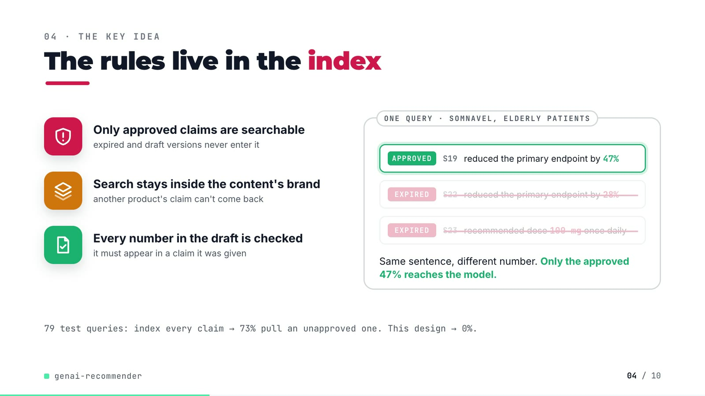
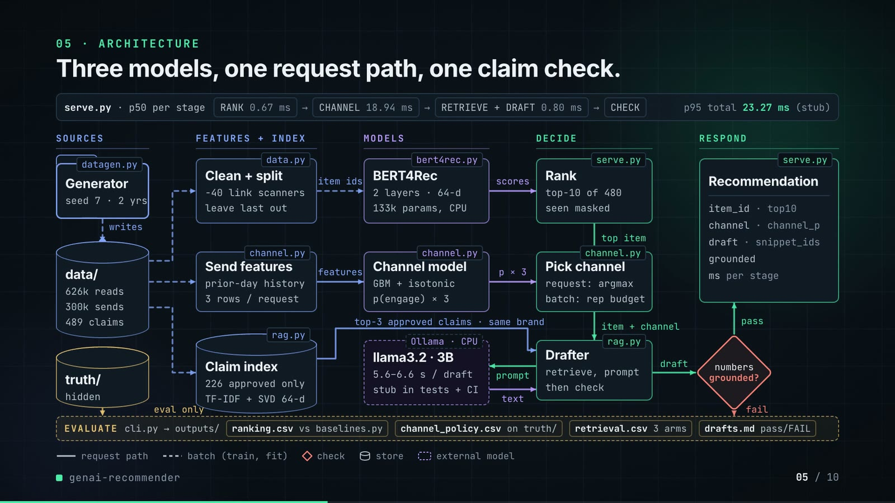
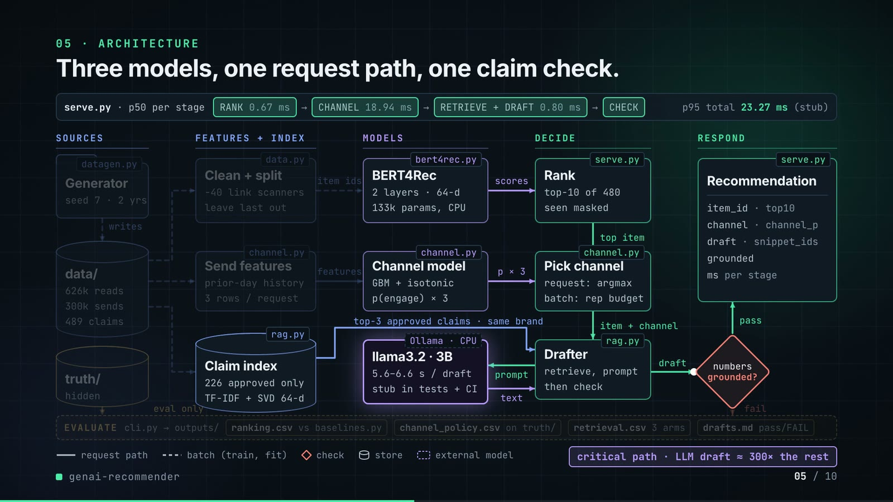
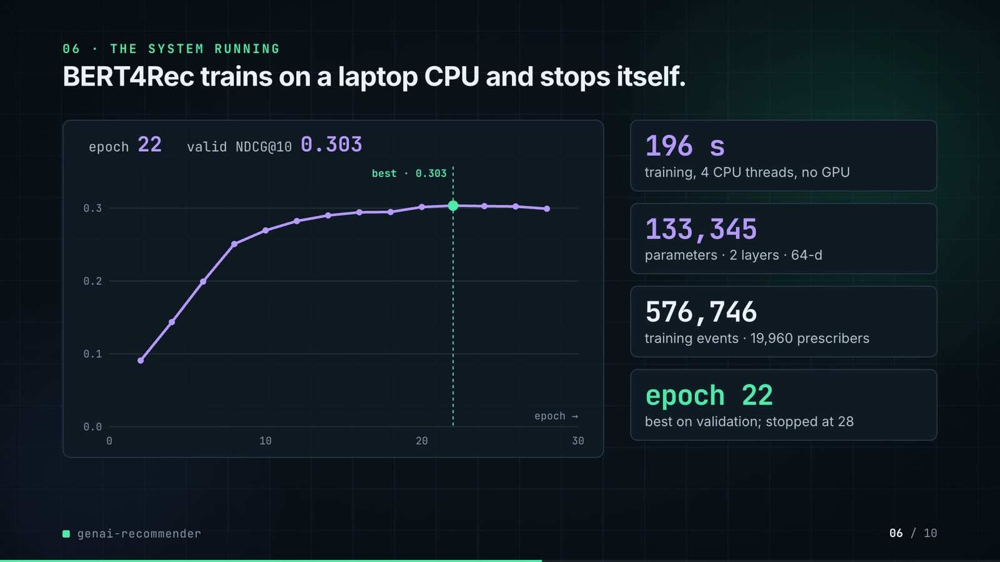
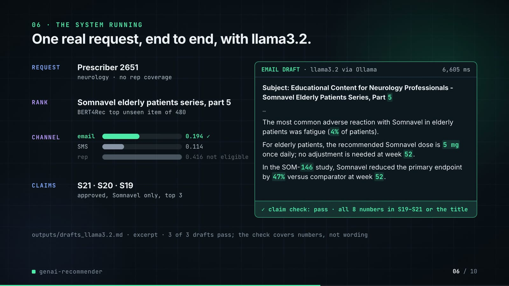
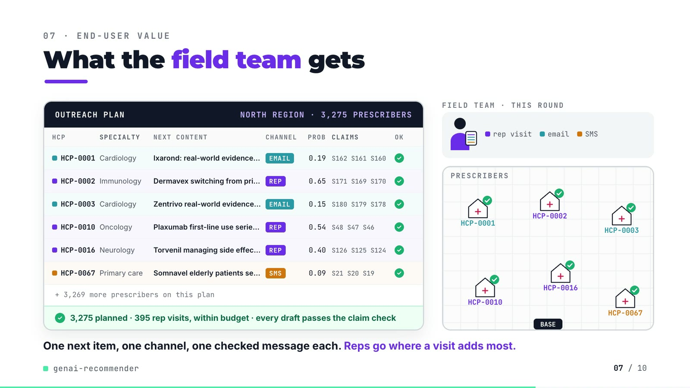
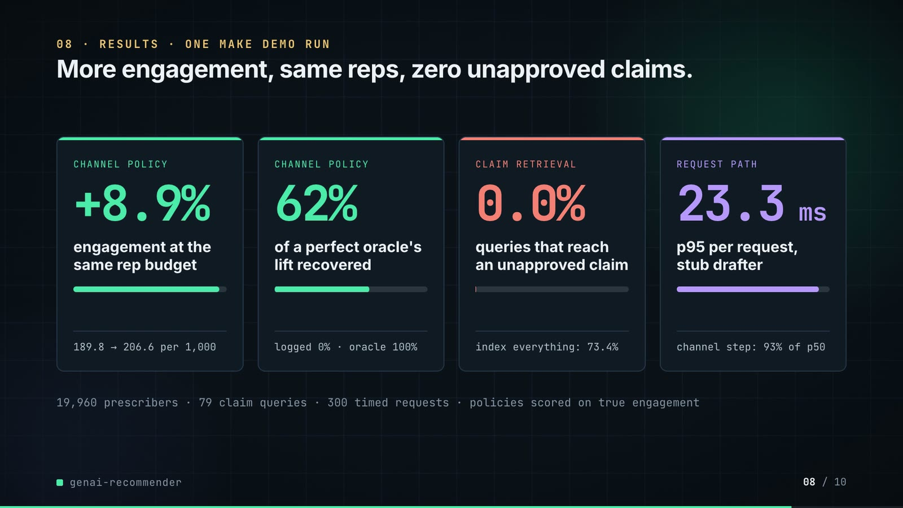
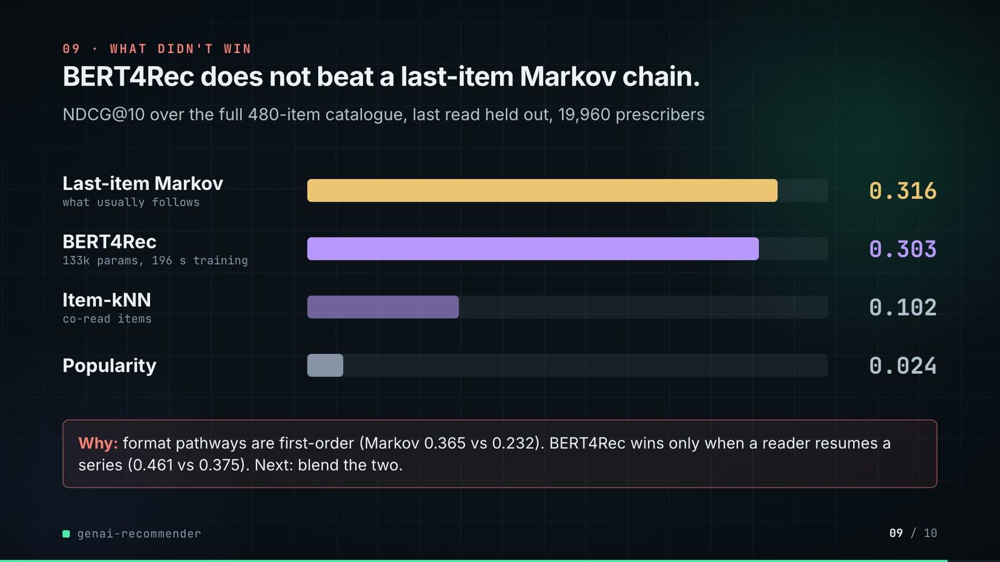

# genai-recommender: demo video audit report

**Repository:** https://github.com/kavya2693/genai-recommender  
**Numbers taken from commit:** `37d49ec` (outputs last changed in `37d49ec (2026-10-14 12:39:30 +0400)`)  
**Video:** `docs/demo/demo.mp4` (85.8 s, 1920x1080, 30 fps, silent)  
**Generated:** 2026-10-14 14:39  
**Automated checks:** 70 pass · 0 fail · 1 manual (of 71 figures)

## How to use this report

Every number or claim on screen has an ID (`F-01`, `F-02`, ...) and every modelling assumption has an ID (`A-01`, ...). Cite the ID. Each figure lists its source file, the exact column/row/key, the formula for derived numbers, and an automated check result. The change-impact matrix tells you which slides and files change if an input or assumption changes.

Types: **direct** = read straight from a repo output; **derived** = computed from direct values (formula given); **illustrative** = drawing or example, not data; **general knowledge** = context not produced by the repo.

### Regenerate

```bash
make demo                                  # outputs/*.csv, summary.json, bert4rec_training.json, drafts_llama3.2.md (~4 min; needs ollama pull llama3.2)
PYTHONPATH=src .venv/bin/python docs/demo/source/tools/export_outreach_plan.py docs/demo/source/assets/outreach_plan.json --region north   # ~6 min, retrains with seed 7
python3 docs/demo/source/tools/inject_sheet.py docs/demo/source/assets/outreach_plan.json docs/demo/source/compositions/value.html --rows 0,1,2,9,15,66
cd docs/demo/source && npx --yes hyperframes@0.8.156 check && npx --yes hyperframes@0.8.156 render -f 30 -q looks -o renders/genai-recommender-master.mp4 && cd -
ffmpeg -y -i docs/demo/source/renders/genai-recommender-master.mp4 -c:v libx264 -preset slow -crf 25 -pix_fmt yuv420p -movflags +faststart -an docs/demo/demo.mp4
python3 docs/demo/source/tools/build_audit_report.py docs/demo/source/audit/facts.yaml --master docs/demo/source/renders/genai-recommender-master.mp4   # stills, checks, MD/DOCX/PDF
```

## 1. Figures

| ID | Shown on screen | Slides | Source | Column / row / key | How computed | Type | Check |
|---|---|---|---|---|---|---|---|
| F-01 | 3 chips | 01 | `author's framing` | - | - | general knowledge | manual: Context statement, not a repo output. |
| F-02 | 4 problem cards | 01 | `README 'The problem'` | README lines 13-27 | - | general knowledge | ✓ verified |
| F-03 | 20,000 prescribers | 02 | `data/customers.csv` | row count | - | direct | ✓ verified |
| F-04 | 480 pieces of content / top-10 of 480 / 480-item catalogue | 02, 05, 09 | `data/items.csv` | row count | - | direct | ✓ verified |
| F-05 | Email, SMS or a rep visit? | 02, 03 | `src/genai_recommender/datagen.py:62` | CHANNELS | - | direct | ✓ verified |
| F-06 | 626,414 reads | 02 | `data/interactions.csv.gz` | row count | - | direct | ✓ verified |
| F-07 | over 2 years / 2 yrs | 02, 05 | `src/genai_recommender/datagen.py:65-66; data/interactions.csv.gz ts` | DAYS = 730; first and last read 2024-09-01 .. 2026-08-31 | span = 729 days + 1 | direct | ✓ verified |
| F-08 | 299,722 logged sends | 02 | `data/sends.csv.gz` | row count | - | direct | ✓ verified |
| F-09 | 252 expired claims look like current ones | 02 | `data/snippets.csv` | status == expired | count | direct | ✓ verified |
| F-10 | 3 green badges | 03 | `outputs/retrieval.csv; outputs/summary.json` | arm 'approved only + brand filter': unapproved = 0, other-brand = 0; stub_grounded_share = 1.0; llm_demo grounded 3/3 | - | derived | ✓ verified |
| F-11 | learns reading order | 03 | `src/genai_recommender/bert4rec.py:105-130` | _training_batch masking | - | direct | ✓ verified |
| F-12 | S19 APPROVED 47% · S22 EXPIRED 28% · S23 EXPIRED 100 mg | 04 | `data/snippets.csv` | snippet_id 19, 22, 23 | - | direct | ✓ verified |
| F-13 | 73% | 04 | `outputs/retrieval.csv` | arm='all statuses indexed', any unapproved claim retrieved (0.7342) | x 100, rounded | direct | ✓ verified |
| F-14 | 3 step statements | 04 | `src/genai_recommender/rag.py:36-37, :57-58, :163` | - | - | direct | ✓ verified |
| F-15 | This design → 0% | 04 | `outputs/retrieval.csv` | arm='approved only + brand filter', any unapproved claim retrieved | x 100 | direct | ✓ verified |
| F-16 | 79 test queries / 79 claim queries | 04, 08 | `outputs/retrieval.csv` | queries | - | direct | ✓ verified |
| F-17 | RANK 0.67 ms | 05 | `outputs/latency.csv` | stage=rank, p50 ms | - | direct | ✓ verified |
| F-18 | CHANNEL 18.94 ms | 05 | `outputs/latency.csv` | stage=channel, p50 ms | - | direct | ✓ verified |
| F-19 | RETRIEVE + DRAFT 0.80 ms | 05 | `outputs/latency.csv` | stage=retrieve+draft, p50 ms | - | direct | ✓ verified |
| F-20 | p95 total 23.27 ms / 23.3 ms | 05, 08 | `outputs/latency.csv` | stage=total, p95 ms | - | direct | ✓ verified |
| F-21 | 626k reads · 300k sends · 489 claims | 05 | `data/interactions.csv.gz, data/sends.csv.gz, data/snippets.csv` | row counts 626,414 / 299,722 / 489 | rounded to thousands | derived | ✓ verified |
| F-22 | −40 link scanners | 05 | `outputs/summary.json` | scanners_dropped | - | direct | ✓ verified |
| F-23 | 226 approved only | 05 | `data/snippets.csv` | status == approved | count | direct | ✓ verified |
| F-24 | TF-IDF + SVD 64-d | 05 | `src/genai_recommender/rag.py:32-44` | SnippetIndex(dim=64) | - | direct | ✓ verified |
| F-25 | 2 layers · 64-d · 133k params | 05, 06, 09 | `outputs/summary.json` | bert4rec.config.layers, dim; bert4rec.parameters = 133,345 | parameters rounded to thousands | direct | ✓ verified |
| F-26 | seed 7 · 2 yrs | 05 | `src/genai_recommender/datagen.py:455, :66` | seed: int = 7; DAYS = 730 | - | direct | ✓ verified |
| F-27 | top-10 of 480 · seen masked | 05 | `src/genai_recommender/serve.py:60-61` | mask_seen, argsort[:10] | - | direct | ✓ verified |
| F-28 | 5.6–6.6 s / draft | 05 | `outputs/summary.json` | llm_demo.draft_ms = [5570, 6178, 6605] | min, max / 1000 | derived | ✓ verified |
| F-29 | LLM draft ≈ 300× the rest | 05 | `outputs/summary.json; README line 149` | mean draft_ms 6,118 / total p50 20.44 ms = 299 | mean(draft_ms) / total p50, rounded to the nearest hundred | derived | ✓ verified |
| F-30 | llama3.2 · 3B · Ollama · CPU · stub in tests + CI | 05 | `README line 148; src/genai_recommender/rag.py StubLLM, OllamaLLM` | - | - | direct | ✓ verified |
| F-31 | datagen.py, data.py, channel.py (x3), rag.py (x2), bert4rec.py, serve.py (x2), cli.py, baselines.py | 05 | `src/genai_recommender/` | functions and classes | - | direct | ✓ verified |
| F-32 | prior-day history · 3 rows / request | 05 | `src/genai_recommender/serve.py:64-72; channel.py:46-58` | - | - | direct | ✓ verified |
| F-33 | 14 points, epochs 2-28 | 06 | `outputs/bert4rec_training.json history` | epoch, valid_ndcg10 | - | direct | ✓ verified |
| F-34 | epoch 22 · 0.303 | 06 | `outputs/bert4rec_training.json` | best_epoch, best_valid_ndcg10 | - | direct | ✓ verified |
| F-35 | stopped at 28 | 06 | `outputs/bert4rec_training.json` | last history epoch | - | direct | ✓ verified |
| F-36 | 196 s | 06 | `outputs/summary.json` | bert4rec.train_seconds | - | direct | ✓ verified |
| F-37 | 4 CPU threads, no GPU | 06 | `README line 57; cli.py --threads default min(4, cpu_count)` | - | - | direct | ✓ verified |
| F-38 | 133,345 | 06 | `outputs/summary.json` | bert4rec.parameters | - | direct | ✓ verified |
| F-39 | 576,746 training events · 19,960 prescribers | 06, 08, 09 | `outputs/summary.json` | split.train_events, split.users | - | direct | ✓ verified |
| F-40 | Prescriber 2651 · Somnavel elderly patients series, part 5 · email 0.194 / SMS 0.114 / rep 0.416 · S21 S20 S19 · 6,605 ms | 06 | `outputs/drafts_llama3.2.md lines 44-49` | Customer 2651 section | - | direct | ✓ verified |
| F-41 | neurology · no rep coverage · rep 0.416 not eligible | 06 | `data/customers.csv` | customer_id 2651 | - | direct | ✓ verified |
| F-42 | claim check: pass · all 8 numbers in S19–S21 or the title | 06 | `outputs/drafts_llama3.2.md; data/snippets.csv; rag.py grounding_check logic` | - | numbers in draft (regex \d+(\.\d+)?) all in claims + title | derived | ✓ verified |
| F-43 | 3 of 3 drafts pass | 06 | `outputs/summary.json` | llm_demo.samples, grounded | - | direct | ✓ verified |
| F-44 | 3,275 prescribers / 3,275 planned | 07 | `demo assets/outreach_plan.json` | prescribers | - | direct | ✓ verified |
| F-45 | 395 rep visits, within budget | 07 | `demo assets/outreach_plan.json` | channels.rep = 395, rep_budget = 435 | 395 <= 435 | direct | ✓ verified |
| F-46 | every draft passes the claim check | 07 | `demo assets/outreach_plan.json` | grounded == prescribers | 3,275 / 3,275 | direct | ✓ verified |
| F-47 | HCP-0001, -0002, -0003, -0010, -0016, -0067 | 07 | `demo assets/outreach_plan.json, injected into compositions/value.html` | rows 0, 1, 2, 9, 15, 66 | HCP id = row position + 1 | direct | ✓ verified |
| F-48 | + 3,269 more prescribers | 07 | `F-44` | 3,275 - 6 | - | derived | ✓ verified |
| F-49 | (supports every slide 07 row) | 07 | `demo assets/outreach_plan.json ranking_check vs outputs/ranking.csv` | HR@10, NDCG@10, coverage@10 per model | equal at 4 decimals | direct | ✓ verified |
| F-50 | +8.9% | 08 | `outputs/channel_policy.csv` | engaged per 1k touches: model 206.64 vs logged 189.77 | (206.64 / 189.77 - 1) x 100 = 8.89% | derived | ✓ verified |
| F-51 | 189.8 → 206.6 per 1,000 | 08 | `outputs/channel_policy.csv` | engaged per 1k touches | - | direct | ✓ verified |
| F-52 | 62% | 08 | `outputs/channel_policy.csv` | policy='model, same rep budget', share of oracle lift (0.6173) | x 100 | direct | ✓ verified |
| F-53 | 0.0% (index everything: 73.4%) | 08 | `outputs/retrieval.csv` | any unapproved claim retrieved | x 100 | direct | ✓ verified |
| F-54 | logged 0% · oracle 100% | 08 | `outputs/channel_policy.csv` | share of oracle lift for logged and oracle | - | direct | ✓ verified |
| F-55 | 23.3 ms | 08 | `outputs/latency.csv` | stage=total, p95 ms | 1 decimal | direct | ✓ verified |
| F-56 | channel step: 93% of p50 | 08 | `outputs/latency.csv` | 18.94 / 20.44 | channel p50 / total p50 x 100 = 92.7% | derived | ✓ verified |
| F-57 | policies scored on true engagement | 08 | `src/genai_recommender/channel.py:274` | docstring | - | direct | ✓ verified |
| F-58 | 300 timed requests | 08 | `outputs/latency.csv` | requests | - | direct | ✓ verified |
| F-59 | one make demo run | 08 | `README line 57; outputs/summary.json llm_demo present` | - | - | direct | ✓ verified |
| F-60 | (rep budget, slide 07 'within budget') | 07, 08 | `outputs/channel_policy.csv; demo assets/outreach_plan.json` | rep share of the logged policy = 0.1328 = export rep_share_historical | - | direct | ✓ verified |
| F-61 | 0.316 | 09 | `outputs/ranking.csv` | model='last-item Markov', NDCG@10 | - | direct | ✓ verified |
| F-62 | 0.303 | 09 | `outputs/ranking.csv` | model='BERT4Rec', NDCG@10 | - | direct | ✓ verified |
| F-63 | 0.102 | 09 | `outputs/ranking.csv` | model='item-kNN', NDCG@10 | - | direct | ✓ verified |
| F-64 | 0.024 | 09 | `outputs/ranking.csv` | model='popularity', NDCG@10 | - | direct | ✓ verified |
| F-65 | Markov 0.365 vs 0.232 | 09 | `outputs/ranking_by_segment.csv` | slice='step=pathway', NDCG@10 | - | direct | ✓ verified |
| F-66 | 0.461 vs 0.375 | 09 | `outputs/ranking_by_segment.csv` | slice='step=series_resume', NDCG@10 | - | direct | ✓ verified |
| F-67 | MIT | 10 | `LICENSE line 1` | - | - | direct | ✓ verified |
| F-68 | PyTorch · scikit-learn · Ollama · llama3.2 · Python | 10 | `pyproject.toml; src/genai_recommender/rag.py` | torch, scikit-learn, OllamaLLM(model='llama3.2') | - | direct | ✓ verified |
| F-69 | $ make demo | 10 | `Makefile` | demo target | - | direct | ✓ verified |
| F-70 | + 3 llama3.2 drafts | 10 | `Makefile demo target` | --demo-n 3 | - | direct | ✓ verified |
| F-71 | ~4 min on CPU | 10 | `outputs/summary.json` | wall_seconds = 233.4 | 233.4 / 60 = 3.9 min | derived | ✓ verified |

## 2. Automated check run (2026-10-14 14:39)

| ID | Expected on slide | Recomputed from repo | Result |
|---|---|---|---|
| F-01 | 3 chips | - | manual |
| F-02 | true | true | ✓ pass |
| F-03 | 20,000 | 20,000 | ✓ pass |
| F-04 | 480 | 480 | ✓ pass |
| F-05 | true | true | ✓ pass |
| F-06 | 626,414 | 626,414 | ✓ pass |
| F-07 | true | true | ✓ pass |
| F-08 | 299,722 | 299,722 | ✓ pass |
| F-09 | 252 | 252 | ✓ pass |
| F-10 | true | true | ✓ pass |
| F-11 | true | true | ✓ pass |
| F-12 | true | true | ✓ pass |
| F-13 | 73% | 73% | ✓ pass |
| F-14 | true | true | ✓ pass |
| F-15 | 0% | 0% | ✓ pass |
| F-16 | 79 | 79 | ✓ pass |
| F-17 | 0.67 | 0.67 | ✓ pass |
| F-18 | 18.94 | 18.94 | ✓ pass |
| F-19 | 0.80 | 0.80 | ✓ pass |
| F-20 | 23.27 | 23.27 | ✓ pass |
| F-21 | 626k 300k 489 | 626k 300k 489 | ✓ pass |
| F-22 | 40 | 40 | ✓ pass |
| F-23 | 226 | 226 | ✓ pass |
| F-24 | true | true | ✓ pass |
| F-25 | 2 64 133k | 2 64 133k | ✓ pass |
| F-26 | true | true | ✓ pass |
| F-27 | true | true | ✓ pass |
| F-28 | 5.6-6.6 | 5.6-6.6 | ✓ pass |
| F-29 | 300x | 300x | ✓ pass |
| F-30 | true | true | ✓ pass |
| F-31 | true | true | ✓ pass |
| F-32 | true | true | ✓ pass |
| F-33 | true | true | ✓ pass |
| F-34 | 22 0.303 | 22 0.303 | ✓ pass |
| F-35 | 28 | 28 | ✓ pass |
| F-36 | 196 s | 196 s | ✓ pass |
| F-37 | true | true | ✓ pass |
| F-38 | 133,345 | 133,345 | ✓ pass |
| F-39 | 576,746 19,960 | 576,746 19,960 | ✓ pass |
| F-40 | true | true | ✓ pass |
| F-41 | true | true | ✓ pass |
| F-42 | true | true | ✓ pass |
| F-43 | 3 of 3 | 3 of 3 | ✓ pass |
| F-44 | 3,275 | 3,275 | ✓ pass |
| F-45 | true | true | ✓ pass |
| F-46 | true | true | ✓ pass |
| F-47 | true | true | ✓ pass |
| F-48 | 3,269 | 3,269 | ✓ pass |
| F-49 | true | true | ✓ pass |
| F-50 | +8.9% | +8.9% | ✓ pass |
| F-51 | 189.8 -> 206.6 | 189.8 -> 206.6 | ✓ pass |
| F-52 | 62% | 62% | ✓ pass |
| F-53 | 0.0% 73.4% | 0.0% 73.4% | ✓ pass |
| F-54 | true | true | ✓ pass |
| F-55 | 23.3 | 23.3 | ✓ pass |
| F-56 | 93% | 93% | ✓ pass |
| F-57 | true | true | ✓ pass |
| F-58 | 300 | 300 | ✓ pass |
| F-59 | true | true | ✓ pass |
| F-60 | true | true | ✓ pass |
| F-61 | 0.316 | 0.316 | ✓ pass |
| F-62 | 0.303 | 0.303 | ✓ pass |
| F-63 | 0.102 | 0.102 | ✓ pass |
| F-64 | 0.024 | 0.024 | ✓ pass |
| F-65 | 0.365 0.232 | 0.365 0.232 | ✓ pass |
| F-66 | 0.461 0.375 | 0.461 0.375 | ✓ pass |
| F-67 | true | true | ✓ pass |
| F-68 | true | true | ✓ pass |
| F-69 | true | true | ✓ pass |
| F-70 | true | true | ✓ pass |
| F-71 | ~4 min | ~4 min | ✓ pass |

## 3. Assumptions register

| ID | Assumption | Source | Used by | Sensitivity: if this changes |
|---|---|---|---|---|
| A-01 | All data is synthetic, produced by a seeded generator sized to the production problem (20,000 prescribers, 480 items, two years, 489 claim snippets). Brand names are invented; the production data is proprietary. | `src/genai_recommender/datagen.py:70-76 (Scale), :455 (seed=7), :66 (DAYS = 730); README 'The data'` | all figures | figures all figures and slides 01, 02, 03, 04, 05, 06, 07, 08, 09, 10 change |
| A-02 | Channel policies are scored with the generator's true engagement probability for the channel each policy picks, on the same test touches (last 20% of sends by time). Real logs would need off-policy estimation or a randomised holdout. | `src/genai_recommender/channel.py:267-321 (_policy_eval), :163-169 (time_split 70/10/20); README 'Known limitations'` | F-50, F-51, F-52, F-54, F-57 | figures F-50, F-51, F-52, F-54, F-57 and slides 08 change |
| A-03 | Rep visits are a fixed budget equal to the logged (historical) number of rep sends in the test window (13.3% of touches); visits go to the touches where a rep beats the best eligible digital channel by the widest predicted margin. The slide 07 export applies the same share to one region. | `src/genai_recommender/channel.py:187-212 (assign_with_rep_budget), :297 (rep_budget); demo tools/export_outreach_plan.py (rep_share)` | F-45, F-50, F-51, F-60 | figures F-45, F-50, F-51, F-60 and slides 07, 08 change |
| A-04 | Latency is measured on one laptop, 300 requests one at a time, one thread, stub drafter, no server or network hop; p50/p95 vary with machine load. | `src/genai_recommender/cli.py:115-140 (request loop, threadpool_limits(limits=1), --latency-n 300); README 'Latency of the request path'` | F-17, F-18, F-19, F-20, F-29, F-55, F-56, F-58 | figures F-17, F-18, F-19, F-20, F-29, F-55, F-56, F-58 and slides 05, 08 change |
| A-05 | The llama3.2 result is three demonstration drafts (3B model, CPU through Ollama, temperature 0.2), not a measured pass rate. | `src/genai_recommender/rag.py:122-138 (OllamaLLM); cli.py:70 (--demo-n 3); README 'Latency of the request path'` | F-28, F-29, F-30, F-40, F-42, F-43, F-70 | figures F-28, F-29, F-30, F-40, F-42, F-43, F-70 and slides 05, 06, 10 change |
| A-06 | The grounding check only checks numbers: every number in a draft must appear in a retrieved approved claim or the content title. Prose that misstates a claim passes (README 'Known limitations', biggest gap). | `src/genai_recommender/rag.py:163-174 (grounding_check)` | F-10, F-14, F-42, F-43, F-46 | figures F-10, F-14, F-42, F-43, F-46 and slides 03, 04, 06, 07 change |
| A-07 | Claim retrieval is scored on 79 brand-topic queries with k = 3; the right claims are known by construction (approved snippets written for that brand and topic). | `src/genai_recommender/rag.py:64-104 (retrieval_eval), :53 (k = 3)` | F-13, F-15, F-16, F-53 | figures F-13, F-15, F-16, F-53 and slides 04, 08 change |
| A-08 | Ranking uses a leave-last-out split (train on all but the last two reads, validate on the second-to-last, test on the last) after dropping prescribers with more than 40 reads in a day (link scanners). All rankers are scored over the full 480-item catalogue with seen items masked. | `src/genai_recommender/data.py:12 (MAX_EVENTS_PER_DAY = 40), :62-84 (make_split); ranking.py:50-54` | F-22, F-27, F-39, F-61, F-62, F-63, F-64, F-65, F-66 | figures F-22, F-27, F-39, F-61, F-62, F-63, F-64, F-65, F-66 and slides 05, 06, 08, 09 change |
| A-09 | BERT4Rec configuration: 2 layers, 64 dimensions, 2 heads, 30-item window, up to 30 epochs evaluated every 2, early stop with patience 3 on validation NDCG@10 over 3,000 sampled prescribers, seed 7. | `src/genai_recommender/bert4rec.py:19-35 (Config); ranking.py:62 (valid_users = 3000)` | F-25, F-33, F-34, F-35, F-36, F-38 | figures F-25, F-33, F-34, F-35, F-36, F-38 and slides 05, 06, 09 change |
| A-10 | Slide 07 plans one touch for every prescriber in the north region at the same point in time the request-path test uses (history before the held-out read), with the deterministic stub drafter. The export retrains every model with the repo's seeds; its ranking table reproduces outputs/ranking.csv exactly. | `demo tools/export_outreach_plan.py; src/genai_recommender/cli.py:115-130 (request)` | F-44, F-45, F-46, F-47, F-48, F-49 | figures F-44, F-45, F-46, F-47, F-48, F-49 and slides 07 change |
| A-11 | Run times depend on the machine: the README run is an Apple M1 Pro laptop on 4 CPU threads, no GPU. | `README 'The result' line 57; outputs/summary.json wall_seconds, bert4rec.train_seconds` | F-36, F-37, F-71 | figures F-36, F-37, F-71 and slides 06, 10 change |
| A-12 | Video rounding: probabilities and NDCG to 3 decimals (2 on the slide 07 sheet), shares to 1 decimal or whole percent, latencies to 2 decimals (1 on slide 08), counts with thousands separators; '626k', '300k', '133k', '~4 min' are rounded labels. | `this audit (display convention)` | F-13, F-21, F-25, F-28, F-29, F-47, F-50, F-52, F-55, F-56, F-71 | figures F-13, F-21, F-25, F-28, F-29, F-47, F-50, F-52, F-55, F-56, F-71 and slides 04, 05, 06, 07, 08, 09, 10 change |
| A-13 | Slide 01 (industry, everyday problems) is general pharma-commercial knowledge used as context, backed by the README problem statement; it carries no numbers. | `author's framing; README 'The problem'` | F-01, F-02 | figures F-01, F-02 and slides 01 change |

## 4. Slide by slide

### Slide 01: The industry  
*0.0-7.2 s · composition `compositions/s01-context.html`*


**On-screen text (verbatim)**

> 01 · THE INDUSTRY  
> Every week, each doctor's next message has to be chosen.  
> WHO LIVES WITH THIS · Pharma & biotech brand teams · Field sales & omnichannel ops · Medical-legal review  
> 01 Everyone in a segment gets the same content — Content that doesn't follow on gets ignored  
> 02 Email, SMS or a rep visit, picked by habit — Reps are the costliest touch and a fixed headcount  
> 03 Only approved claims may be quoted — An outdated figure is a compliance incident  
> 04 Old and new claims read almost the same — Only the numbers change between versions  
> THIS PROJECT tackles all four, end to end · what to send → which channel → what it says  

**Figures on this slide**

| ID | Shown | Source · key | Calculation | Check |
|---|---|---|---|---|
| F-01 | 3 chips | `author's framing` · - | - | manual |
| F-02 | 4 problem cards | `README 'The problem'` · README lines 13-27 | - | ✓ |

**Assumptions:** A-13

**Illustrative, not data:**

- The whole slide is context; no repo figures.

**To change this slide:** Edit the chips (#ctx-c1..3) and cards (#ctx-k1..4) in compositions/s01-context.html. (project folder `docs/demo/source`).

### Slide 02: This project  
*6.8-11.6 s · composition `compositions/s02-hook.html`*


**On-screen text (verbatim)**

> 02 · THIS PROJECT  
> 20,000 prescribers. 480 pieces of content. Email, SMS or a rep visit?  
> 626,414 reads over 2 years · 299,722 logged sends · 252 expired claims look like current ones  

**Figures on this slide**

| ID | Shown | Source · key | Calculation | Check |
|---|---|---|---|---|
| F-03 | 20,000 prescribers | `data/customers.csv` · row count | - | ✓ |
| F-04 | 480 pieces of content / top-10 of 480 / 480-item catalogue | `data/items.csv` · row count | - | ✓ |
| F-05 | Email, SMS or a rep visit? | `src/genai_recommender/datagen.py:62` · CHANNELS | - | ✓ |
| F-06 | 626,414 reads | `data/interactions.csv.gz` · row count | - | ✓ |
| F-07 | over 2 years / 2 yrs | `src/genai_recommender/datagen.py:65-66; data/interactions.csv.gz ts` · DAYS = 730; first and last read 2024-09-01 .. 2026-08-31 | span = 729 days + 1 | ✓ |
| F-08 | 299,722 logged sends | `data/sends.csv.gz` · row count | - | ✓ |
| F-09 | 252 expired claims look like current ones | `data/snippets.csv` · status == expired | count | ✓ |

**Assumptions:** A-01

**Illustrative, not data:**

- Rings in the background are decoration.

**To change this slide:** Headline spans #hook-l1..l3 and chips #hook-f1..f3 in compositions/s02-hook.html; counts come from data/ (datagen.py Scale). (project folder `docs/demo/source`).

### Slide 03: How it works (white chapter, slide A)  
*11.3-19.3 s · composition `compositions/explainer.html (CONFIG.blocks, CONFIG.groups, CONFIG.loop)`*


**On-screen text (verbatim)**

> 03 · HOW IT WORKS  
> From reading history to a message  
> READING what each doctor read → [RECOMMEND: NEXT CONTENT what to send next → CHANNEL email, SMS or a visit?] → [GROUNDED DRAFT: CLAIMS approved ones only → WRITE a local language model drafts] → MESSAGE OUT ✓ approved claims ✓ right brand ✓ numbers checked  
> learns reading order (loop over NEXT CONTENT)  

**Figures on this slide**

| ID | Shown | Source · key | Calculation | Check |
|---|---|---|---|---|
| F-05 | Email, SMS or a rep visit? | `src/genai_recommender/datagen.py:62` · CHANNELS | - | ✓ |
| F-10 | 3 green badges | `outputs/retrieval.csv; outputs/summary.json` · arm 'approved only + brand filter': unapproved = 0, other-brand = 0; stub_grounded_share = 1.0; llm_demo grounded 3/3 | - | ✓ |
| F-11 | learns reading order | `src/genai_recommender/bert4rec.py:105-130` · _training_batch masking | - | ✓ |

**Assumptions:** A-06, A-07

**Illustrative, not data:**

- Icons and colours are a visual language, not data.
- 'numbers checked' means the number-only grounding check (A-06).

**To change this slide:** Edit CONFIG in compositions/explainer.html; badge truth comes from retrieval.csv and summary.json (F-10). (project folder `docs/demo/source`).

### Slide 04: The key idea (white chapter, slide B)  
*19.3-26.3 s · composition `compositions/explainer.html (#ex-b ...)`*



**On-screen text (verbatim)**

> 04 · THE KEY IDEA  
> The rules live in the index  
> Only approved claims are searchable — expired and draft versions never enter it  
> Search stays inside the content's brand — another product's claim can't come back  
> Every number in the draft is checked — it must appear in a claim it was given  
> ONE QUERY · SOMNAVEL, ELDERLY PATIENTS: APPROVED S19 reduced the primary endpoint by 47% · EXPIRED S22 reduced the primary endpoint by 28% (struck) · EXPIRED S23 recommended dose 100 mg once daily (struck)  
> Same sentence, different number. Only the approved 47% reaches the model.  
> 79 test queries: index every claim → 73% pull an unapproved one. This design → 0%.  

**Figures on this slide**

| ID | Shown | Source · key | Calculation | Check |
|---|---|---|---|---|
| F-12 | S19 APPROVED 47% · S22 EXPIRED 28% · S23 EXPIRED 100 mg | `data/snippets.csv` · snippet_id 19, 22, 23 | - | ✓ |
| F-13 | 73% | `outputs/retrieval.csv` · arm='all statuses indexed', any unapproved claim retrieved (0.7342) | x 100, rounded | ✓ |
| F-14 | 3 step statements | `src/genai_recommender/rag.py:36-37, :57-58, :163` · - | - | ✓ |
| F-15 | This design → 0% | `outputs/retrieval.csv` · arm='approved only + brand filter', any unapproved claim retrieved | x 100 | ✓ |
| F-16 | 79 test queries / 79 claim queries | `outputs/retrieval.csv` · queries | - | ✓ |

**Assumptions:** A-06, A-07, A-12

**Illustrative, not data:**

- The three claim cards are real snippets (S19, S22, S23) shortened to their claim; the strike-out animation illustrates that expired claims are never indexed (they are filtered before embedding, not removed at query time).
- The grounding check also accepts numbers from the content title (A-06).

**To change this slide:** Markup under #ex-b in compositions/explainer.html; the footnote figures are F-13, F-15, F-16. (project folder `docs/demo/source`).

### Slide 05: Architecture  
*26.0-40.6 s · composition `compositions/s03-architecture.html`*





**On-screen text (verbatim)**

> 05 · ARCHITECTURE  
> Three models, one request path, one claim check.  
> serve.py · p50 per stage: RANK 0.67 ms → CHANNEL 18.94 ms → RETRIEVE + DRAFT 0.80 ms → CHECK · p95 total 23.27 ms (stub)  
> SOURCES: datagen.py Generator (seed 7 · 2 yrs) → writes → data/ (626k reads, 300k sends, 489 claims); truth/ (hidden) → eval only  
> FEATURES + INDEX: data.py Clean + split (−40 link scanners, leave last out); channel.py Send features (prior-day history, 3 rows / request); rag.py Claim index (226 approved only, TF-IDF + SVD 64-d)  
> MODELS: bert4rec.py BERT4Rec (2 layers · 64-d, 133k params, CPU); channel.py Channel model (GBM + isotonic, p(engage) × 3); Ollama · CPU llama3.2 · 3B (5.6–6.6 s / draft, stub in tests + CI)  
> DECIDE: serve.py Rank (top-10 of 480, seen masked); channel.py Pick channel (request: argmax, batch: rep budget); rag.py Drafter (retrieve, prompt, then check)  
> RESPOND: numbers grounded? → pass → serve.py Recommendation (item_id · top10, channel · channel_p, draft · snippet_ids, grounded, ms per stage); fail → drafts.md  
> Edge labels: item ids, scores, features, p × 3, top item, item + channel, top-3 approved claims · same brand, prompt, text, draft, pass, fail, writes, eval only  
> EVALUATE cli.py → outputs/ · ranking.csv vs baselines.py · channel_policy.csv on truth/ · retrieval.csv 3 arms · drafts.md pass/FAIL  
> Legend: request path · batch (train, fit) · check · store · external model  
> critical path · LLM draft ≈ 300× the rest  

**Figures on this slide**

| ID | Shown | Source · key | Calculation | Check |
|---|---|---|---|---|
| F-04 | 480 pieces of content / top-10 of 480 / 480-item catalogue | `data/items.csv` · row count | - | ✓ |
| F-07 | over 2 years / 2 yrs | `src/genai_recommender/datagen.py:65-66; data/interactions.csv.gz ts` · DAYS = 730; first and last read 2024-09-01 .. 2026-08-31 | span = 729 days + 1 | ✓ |
| F-17 | RANK 0.67 ms | `outputs/latency.csv` · stage=rank, p50 ms | - | ✓ |
| F-18 | CHANNEL 18.94 ms | `outputs/latency.csv` · stage=channel, p50 ms | - | ✓ |
| F-19 | RETRIEVE + DRAFT 0.80 ms | `outputs/latency.csv` · stage=retrieve+draft, p50 ms | - | ✓ |
| F-20 | p95 total 23.27 ms / 23.3 ms | `outputs/latency.csv` · stage=total, p95 ms | - | ✓ |
| F-21 | 626k reads · 300k sends · 489 claims | `data/interactions.csv.gz, data/sends.csv.gz, data/snippets.csv` · row counts 626,414 / 299,722 / 489 | rounded to thousands | ✓ |
| F-22 | −40 link scanners | `outputs/summary.json` · scanners_dropped | - | ✓ |
| F-23 | 226 approved only | `data/snippets.csv` · status == approved | count | ✓ |
| F-24 | TF-IDF + SVD 64-d | `src/genai_recommender/rag.py:32-44` · SnippetIndex(dim=64) | - | ✓ |
| F-25 | 2 layers · 64-d · 133k params | `outputs/summary.json` · bert4rec.config.layers, dim; bert4rec.parameters = 133,345 | parameters rounded to thousands | ✓ |
| F-26 | seed 7 · 2 yrs | `src/genai_recommender/datagen.py:455, :66` · seed: int = 7; DAYS = 730 | - | ✓ |
| F-27 | top-10 of 480 · seen masked | `src/genai_recommender/serve.py:60-61` · mask_seen, argsort[:10] | - | ✓ |
| F-28 | 5.6–6.6 s / draft | `outputs/summary.json` · llm_demo.draft_ms = [5570, 6178, 6605] | min, max / 1000 | ✓ |
| F-29 | LLM draft ≈ 300× the rest | `outputs/summary.json; README line 149` · mean draft_ms 6,118 / total p50 20.44 ms = 299 | mean(draft_ms) / total p50, rounded to the nearest hundred | ✓ |
| F-30 | llama3.2 · 3B · Ollama · CPU · stub in tests + CI | `README line 148; src/genai_recommender/rag.py StubLLM, OllamaLLM` · - | - | ✓ |
| F-31 | datagen.py, data.py, channel.py (x3), rag.py (x2), bert4rec.py, serve.py (x2), cli.py, baselines.py | `src/genai_recommender/` · functions and classes | - | ✓ |
| F-32 | prior-day history · 3 rows / request | `src/genai_recommender/serve.py:64-72; channel.py:46-58` · - | - | ✓ |

- *F-29 note:* The README states 'roughly 300 times the rest of the request path combined'.

**Assumptions:** A-01, A-04, A-05, A-06, A-08, A-09

**Illustrative, not data:**

- Packets moving along the wires show execution order, not timing.
- Solid wires = the per-request path in serve.py; dashed = batch work done once per run (generate, split, train, fit, score).
- The fail branch: grounding_check marks the draft grounded=false with the ungrounded numbers, and cli.py writes it as FAIL in drafts_*.md; there is no automatic retry or human approval step in the repo (README 'Known limitations').
- Pick channel takes the eligible argmax per request; the rep budget applies only in the batch policy (README 'How it works').

**To change this slide:** NODES and the W (wires) object in compositions/s03-architecture.html; band numbers from outputs/latency.csv. (project folder `docs/demo/source`).

### Slide 06: The system running  
*40.2-54.8 s · composition `compositions/s04-routes.html (HIST array, request trace markup)`*





**On-screen text (verbatim)**

> 06 · THE SYSTEM RUNNING  
> BERT4Rec trains on a laptop CPU and stops itself.  
> epoch 22 · valid NDCG@10 0.303 (curve of 14 evaluation points, best · 0.303 marker)  
> 196 s training, 4 CPU threads, no GPU · 133,345 parameters · 2 layers · 64-d · 576,746 training events · 19,960 prescribers · epoch 22 best on validation; stopped at 28  
> One real request, end to end, with llama3.2.  
> REQUEST Prescriber 2651 (neurology · no rep coverage) · RANK Somnavel elderly patients series, part 5 (BERT4Rec top unseen item of 480) · CHANNEL email 0.194 ✓, SMS 0.114, rep 0.416 not eligible · CLAIMS S21 · S20 · S19 (approved, Somnavel only, top 3)  
> EMAIL DRAFT · llama3.2 via Ollama · 6,605 ms — Subject line + 3 claim sentences (excerpt) — ✓ claim check: pass · all 8 numbers in S19–S21 or the title  
> outputs/drafts_llama3.2.md · excerpt · 3 of 3 drafts pass; the check covers numbers, not wording  

**Figures on this slide**

| ID | Shown | Source · key | Calculation | Check |
|---|---|---|---|---|
| F-25 | 2 layers · 64-d · 133k params | `outputs/summary.json` · bert4rec.config.layers, dim; bert4rec.parameters = 133,345 | parameters rounded to thousands | ✓ |
| F-33 | 14 points, epochs 2-28 | `outputs/bert4rec_training.json history` · epoch, valid_ndcg10 | - | ✓ |
| F-34 | epoch 22 · 0.303 | `outputs/bert4rec_training.json` · best_epoch, best_valid_ndcg10 | - | ✓ |
| F-35 | stopped at 28 | `outputs/bert4rec_training.json` · last history epoch | - | ✓ |
| F-36 | 196 s | `outputs/summary.json` · bert4rec.train_seconds | - | ✓ |
| F-37 | 4 CPU threads, no GPU | `README line 57; cli.py --threads default min(4, cpu_count)` · - | - | ✓ |
| F-38 | 133,345 | `outputs/summary.json` · bert4rec.parameters | - | ✓ |
| F-39 | 576,746 training events · 19,960 prescribers | `outputs/summary.json` · split.train_events, split.users | - | ✓ |
| F-40 | Prescriber 2651 · Somnavel elderly patients series, part 5 · email 0.194 / SMS 0.114 / rep 0.416 · S21 S20 S19 · 6,605 ms | `outputs/drafts_llama3.2.md lines 44-49` · Customer 2651 section | - | ✓ |
| F-41 | neurology · no rep coverage · rep 0.416 not eligible | `data/customers.csv` · customer_id 2651 | - | ✓ |
| F-42 | claim check: pass · all 8 numbers in S19–S21 or the title | `outputs/drafts_llama3.2.md; data/snippets.csv; rag.py grounding_check logic` · - | numbers in draft (regex \d+(\.\d+)?) all in claims + title | ✓ |
| F-43 | 3 of 3 drafts pass | `outputs/summary.json` · llm_demo.samples, grounded | - | ✓ |

**Assumptions:** A-05, A-06, A-09, A-11

**Illustrative, not data:**

- The curve is drawn from bert4rec_training.json (F-33); the readout steps through the logged points.
- The draft card shows the subject and the three claim sentences of the real draft; the greeting and closing lines are elided ('…').
- The latency counter animates up to the logged 6,605 ms; it is not a live timer.

**To change this slide:** HIST array and trace markup in compositions/s04-routes.html; the trace is the Customer 2651 section of outputs/drafts_llama3.2.md. (project folder `docs/demo/source`).

### Slide 07: End-user value (white)  
*54.5-67.5 s · composition `compositions/value.html (SHEET block injected by tools/inject_sheet.py)`*



**On-screen text (verbatim)**

> 07 · END-USER VALUE  
> What the field team gets  
> OUTREACH PLAN · NORTH REGION · 3,275 PRESCRIBERS — columns HCP, SPECIALTY, NEXT CONTENT, CHANNEL, PROB, CLAIMS, OK  
> HCP-0001 Cardiology · Ixarond: real-world evidence (article) · EMAIL 0.19 · S162 S161 S160 ✓  
> HCP-0002 Immunology · Dermavex switching from prior therapy series, part … · REP 0.65 · S171 S169 S170 ✓  
> HCP-0003 Cardiology · Zentrivo real-world evidence series, part 5 · EMAIL 0.15 · S180 S179 S178 ✓  
> HCP-0010 Oncology · Plaxumab first-line use series, part 4 · REP 0.54 · S48 S47 S46 ✓  
> HCP-0016 Neurology · Torvenil managing side effects series, part 1 · REP 0.40 · S126 S125 S124 ✓  
> HCP-0067 Primary care · Somnavel elderly patients series, part 4 · SMS 0.09 · S21 S20 S19 ✓  
> + 3,269 more prescribers on this plan · ✓ 3,275 planned · 395 rep visits, within budget · every draft passes the claim check  
> FIELD TEAM · THIS ROUND · rep visit / email / SMS · PRESCRIBERS · BASE  
> One next item, one channel, one checked message each. Reps go where a visit adds most.  

**Figures on this slide**

| ID | Shown | Source · key | Calculation | Check |
|---|---|---|---|---|
| F-44 | 3,275 prescribers / 3,275 planned | `demo assets/outreach_plan.json` · prescribers | - | ✓ |
| F-45 | 395 rep visits, within budget | `demo assets/outreach_plan.json` · channels.rep = 395, rep_budget = 435 | 395 <= 435 | ✓ |
| F-46 | every draft passes the claim check | `demo assets/outreach_plan.json` · grounded == prescribers | 3,275 / 3,275 | ✓ |
| F-47 | HCP-0001, -0002, -0003, -0010, -0016, -0067 | `demo assets/outreach_plan.json, injected into compositions/value.html` · rows 0, 1, 2, 9, 15, 66 | HCP id = row position + 1 | ✓ |
| F-48 | + 3,269 more prescribers | `F-44` · 3,275 - 6 | - | ✓ |
| F-49 | (supports every slide 07 row) | `demo assets/outreach_plan.json ranking_check vs outputs/ranking.csv` · HR@10, NDCG@10, coverage@10 per model | equal at 4 decimals | ✓ |
| F-60 | (rep budget, slide 07 'within budget') | `outputs/channel_policy.csv; demo assets/outreach_plan.json` · rep share of the logged policy = 0.1328 = export rep_share_historical | - | ✓ |

**Assumptions:** A-03, A-06, A-10, A-12

**Illustrative, not data:**

- HCP-xxxx are row positions in the export, not real people.
- Content titles are truncated on screen to fit the column.
- Clinic positions, the base, the rep figure, envelopes, SMS bubbles and the car are illustrative; the data has no geography.
- Green checks on clinics mean the claim-checked message was planned for that prescriber, not that the prescriber engaged.
- 'Reps go where a visit adds most' paraphrases the rep-budget rule (largest predicted rep-over-digital margin, A-03).

**To change this slide:** Re-run tools/export_outreach_plan.py, then tools/inject_sheet.py (--rows picks the rows); layout in compositions/value.html. (project folder `docs/demo/source`).

### Slide 08: Results  
*67.2-76.0 s · composition `compositions/s05-results.html (stats array)`*



**On-screen text (verbatim)**

> 08 · RESULTS · ONE MAKE DEMO RUN  
> More engagement, same reps, zero unapproved claims.  
> CHANNEL POLICY +8.9% engagement at the same rep budget · 189.8 → 206.6 per 1,000  
> CHANNEL POLICY 62% of a perfect oracle's lift recovered · logged 0% · oracle 100%  
> CLAIM RETRIEVAL 0.0% queries that reach an unapproved claim · index everything: 73.4%  
> REQUEST PATH 23.3 ms p95 per request, stub drafter · channel step: 93% of p50  
> 19,960 prescribers · 79 claim queries · 300 timed requests · policies scored on true engagement  

**Figures on this slide**

| ID | Shown | Source · key | Calculation | Check |
|---|---|---|---|---|
| F-16 | 79 test queries / 79 claim queries | `outputs/retrieval.csv` · queries | - | ✓ |
| F-20 | p95 total 23.27 ms / 23.3 ms | `outputs/latency.csv` · stage=total, p95 ms | - | ✓ |
| F-39 | 576,746 training events · 19,960 prescribers | `outputs/summary.json` · split.train_events, split.users | - | ✓ |
| F-50 | +8.9% | `outputs/channel_policy.csv` · engaged per 1k touches: model 206.64 vs logged 189.77 | (206.64 / 189.77 - 1) x 100 = 8.89% | ✓ |
| F-51 | 189.8 → 206.6 per 1,000 | `outputs/channel_policy.csv` · engaged per 1k touches | - | ✓ |
| F-52 | 62% | `outputs/channel_policy.csv` · policy='model, same rep budget', share of oracle lift (0.6173) | x 100 | ✓ |
| F-53 | 0.0% (index everything: 73.4%) | `outputs/retrieval.csv` · any unapproved claim retrieved | x 100 | ✓ |
| F-54 | logged 0% · oracle 100% | `outputs/channel_policy.csv` · share of oracle lift for logged and oracle | - | ✓ |
| F-55 | 23.3 ms | `outputs/latency.csv` · stage=total, p95 ms | 1 decimal | ✓ |
| F-56 | channel step: 93% of p50 | `outputs/latency.csv` · 18.94 / 20.44 | channel p50 / total p50 x 100 = 92.7% | ✓ |
| F-57 | policies scored on true engagement | `src/genai_recommender/channel.py:274` · docstring | - | ✓ |
| F-58 | 300 timed requests | `outputs/latency.csv` · requests | - | ✓ |
| F-59 | one make demo run | `README line 57; outputs/summary.json llm_demo present` · - | - | ✓ |
| F-60 | (rep budget, slide 07 'within budget') | `outputs/channel_policy.csv; demo assets/outreach_plan.json` · rep share of the logged policy = 0.1328 = export rep_share_historical | - | ✓ |

**Assumptions:** A-02, A-03, A-04, A-07, A-12

**Illustrative, not data:**

- Mini bars: card 1 = engaged per 1,000 as a share of the oracle's 217.1 (logged → model); card 2 = share of oracle lift; card 3 = 73.4% → 0%; card 4 = channel step's share of the p50 request.

**To change this slide:** The stats array and card text in compositions/s05-results.html. (project folder `docs/demo/source`).

### Slide 09: What didn't win  
*75.6-81.8 s · composition `compositions/s06-twist.html`*



**On-screen text (verbatim)**

> 09 · WHAT DIDN'T WIN  
> BERT4Rec does not beat a last-item Markov chain.  
> NDCG@10 over the full 480-item catalogue, last read held out, 19,960 prescribers  
> Last-item Markov (what usually follows) 0.316 · BERT4Rec (133k params, 196 s training) 0.303 · Item-kNN (co-read items) 0.102 · Popularity 0.024  
> Why: format pathways are first-order (Markov 0.365 vs 0.232). BERT4Rec wins only when a reader resumes a series (0.461 vs 0.375). Next: blend the two.  

**Figures on this slide**

| ID | Shown | Source · key | Calculation | Check |
|---|---|---|---|---|
| F-04 | 480 pieces of content / top-10 of 480 / 480-item catalogue | `data/items.csv` · row count | - | ✓ |
| F-25 | 2 layers · 64-d · 133k params | `outputs/summary.json` · bert4rec.config.layers, dim; bert4rec.parameters = 133,345 | parameters rounded to thousands | ✓ |
| F-39 | 576,746 training events · 19,960 prescribers | `outputs/summary.json` · split.train_events, split.users | - | ✓ |
| F-61 | 0.316 | `outputs/ranking.csv` · model='last-item Markov', NDCG@10 | - | ✓ |
| F-62 | 0.303 | `outputs/ranking.csv` · model='BERT4Rec', NDCG@10 | - | ✓ |
| F-63 | 0.102 | `outputs/ranking.csv` · model='item-kNN', NDCG@10 | - | ✓ |
| F-64 | 0.024 | `outputs/ranking.csv` · model='popularity', NDCG@10 | - | ✓ |
| F-65 | Markov 0.365 vs 0.232 | `outputs/ranking_by_segment.csv` · slice='step=pathway', NDCG@10 | - | ✓ |
| F-66 | 0.461 vs 0.375 | `outputs/ranking_by_segment.csv` · slice='step=series_resume', NDCG@10 | - | ✓ |

**Assumptions:** A-08, A-09, A-12

**Illustrative, not data:**

- Bar lengths: 1,000 px track = NDCG@10 0.35.

**To change this slide:** Rows #twist-r1..r4 (bar widths are inline styles) in compositions/s06-twist.html. (project folder `docs/demo/source`).

### Slide 10: End card  
*81.4-85.8 s · composition `compositions/s07-end.html`*


**On-screen text (verbatim)**

> 10 · OPEN SOURCE · MIT · RUNS ON A LAPTOP  
> genai-recommender  
> github.com/kavya2693/genai-recommender  
> PyTorch · scikit-learn · Ollama · llama3.2 · Python  
> $ make demo   # 19,960 prescribers + 3 llama3.2 drafts, ~4 min on CPU  

**Figures on this slide**

| ID | Shown | Source · key | Calculation | Check |
|---|---|---|---|---|
| F-67 | MIT | `LICENSE line 1` · - | - | ✓ |
| F-68 | PyTorch · scikit-learn · Ollama · llama3.2 · Python | `pyproject.toml; src/genai_recommender/rag.py` · torch, scikit-learn, OllamaLLM(model='llama3.2') | - | ✓ |
| F-69 | $ make demo | `Makefile` · demo target | - | ✓ |
| F-70 | + 3 llama3.2 drafts | `Makefile demo target` · --demo-n 3 | - | ✓ |
| F-71 | ~4 min on CPU | `outputs/summary.json` · wall_seconds = 233.4 | 233.4 / 60 = 3.9 min | ✓ |

**Assumptions:** A-11, A-12

**To change this slide:** Text in compositions/s07-end.html. (project folder `docs/demo/source`).

## 5. Change-impact matrix

| Input / assumption | Affected figures | Affected slides | Files to edit | Commands to re-run |
|---|---|---|---|---|
| A-01: All data is synthetic, produced by a seeded generator sized to the production problem (20,000 prescribers, 480 items, two years, 489 claim snippets) | all figures | 01, 02, 03, 04, 05, 06, 07, 08, 09, 10 | `src/genai_recommender/datagen.py (Scale)` | `make data; make demo` |
| A-02: Channel policies are scored with the generator's true engagement probability for the channel each policy picks, on the same test touches (last 20% of sends by time) | F-50, F-51, F-52, F-54, F-57 | 08 | `src/genai_recommender/channel.py` | `make demo` |
| A-03: Rep visits are a fixed budget equal to the logged (historical) number of rep sends in the test window (13 | F-45, F-50, F-51, F-60 | 07, 08 | `src/genai_recommender/channel.py:297; tools/export_outreach_plan.py` | `make demo; export_outreach_plan.py + inject_sheet.py` |
| A-04: Latency is measured on one laptop, 300 requests one at a time, one thread, stub drafter, no server or network hop; p50/p95 vary with machine load | F-17, F-18, F-19, F-20, F-29, F-55, F-56, F-58 | 05, 08 | `src/genai_recommender/cli.py:71` | `make demo` |
| A-05: The llama3 | F-28, F-29, F-30, F-40, F-42, F-43, F-70 | 05, 06, 10 | `Makefile (demo target); src/genai_recommender/rag.py:130` | `make demo` |
| A-06: The grounding check only checks numbers: every number in a draft must appear in a retrieved approved claim or the content title | F-10, F-14, F-42, F-43, F-46 | 03, 04, 06, 07 | `src/genai_recommender/rag.py:163-174` | `make demo` |
| A-07: Claim retrieval is scored on 79 brand-topic queries with k = 3; the right claims are known by construction (approved snippets written for that brand and topic) | F-13, F-15, F-16, F-53 | 04, 08 | `src/genai_recommender/rag.py` | `make demo` |
| A-08: Ranking uses a leave-last-out split (train on all but the last two reads, validate on the second-to-last, test on the last) after dropping prescribers with more than 40 reads in a day (link scanners) | F-22, F-27, F-39, F-61, F-62, F-63, F-64, F-65, F-66 | 05, 06, 08, 09 | `src/genai_recommender/data.py` | `make demo` |
| A-09: BERT4Rec configuration: 2 layers, 64 dimensions, 2 heads, 30-item window, up to 30 epochs evaluated every 2, early stop with patience 3 on validation NDCG@10 over 3,000 sampled prescribers, seed 7 | F-25, F-33, F-34, F-35, F-36, F-38 | 05, 06, 09 | `src/genai_recommender/bert4rec.py:19-35` | `make demo; export_outreach_plan.py + inject_sheet.py` |
| A-10: Slide 07 plans one touch for every prescriber in the north region at the same point in time the request-path test uses (history before the held-out read), with the deterministic stub drafter | F-44, F-45, F-46, F-47, F-48, F-49 | 07 | `tools/export_outreach_plan.py (--region); tools/inject_sheet.py (--rows)` | `export_outreach_plan.py + inject_sheet.py; hyperframes render` |
| A-11: Run times depend on the machine: the README run is an Apple M1 Pro laptop on 4 CPU threads, no GPU | F-36, F-37, F-71 | 06, 10 | `-` | `make demo` |
| A-12: Video rounding: probabilities and NDCG to 3 decimals (2 on the slide 07 sheet), shares to 1 decimal or whole percent, latencies to 2 decimals (1 on slide 08), counts with thousands separators; '626k', '300k', '133k', '~4 min' are rounded labels | F-13, F-21, F-25, F-28, F-29, F-47, F-50, F-52, F-55, F-56, F-71 | 04, 05, 06, 07, 08, 09, 10 | `the composition file named on each slide` | `hyperframes render` |
| A-13: Slide 01 (industry, everyday problems) is general pharma-commercial knowledge used as context, backed by the README problem statement; it carries no numbers | F-01, F-02 | 01 | `compositions/s01-context.html` | `hyperframes render` |

## 6. Known differences and caveats

- Channel-policy numbers (+8.9%, 62%) are scored with the generator's own engagement function, which real logs do not provide (A-02).
- The claim check covers numbers only; README 'Known limitations' shows two of the three llama3.2 drafts passing it while misstating a claim's prose. Slide 06 shows the one draft whose prose follows its claims.
- llama3.2 results are three demonstration drafts, not a pass rate (A-05).
- Latency is single-machine, single-thread, stub drafter; the max column (53.82 ms) is first-touch outliers (README).
- The headline sequence result depends on the generator: format pathways are first-order by construction, which favours the Markov chain (README 'Known limitations').
- Slide 07 is one region's plan exported by re-running the repo's pipeline (A-10); HCP ids are row positions, not people.
- Slide 01 statements are general industry knowledge (A-13).

## Appendix: environment

- Commit: `37d49ecc8dcf2a405ea628ac0a26027e2d2aaa41`
- Python: 3.11.7
- torch 2.9.1
- sklearn 1.9.1
- pandas 3.0.6
- numpy 2.4.6
- Profile / seeds: data_generator=7, bert4rec=7, latency_sample_rng=1, validation_users_rng=0
- Run time: summary.json wall_seconds = 233.4 s for make demo (README: Apple M1 Pro laptop, 4 threads, no GPU, including three llama3.2 drafts); the slide 07 export took 351.9 s
